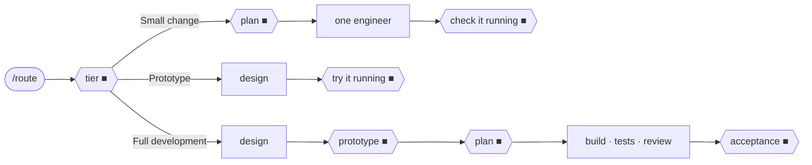

# Claude Harness

A software-development agent team for Claude Code: backend and frontend roles, human sign-offs, automatic gates.

---

## Description

Your Claude Code session becomes the orchestrator. It asks you a few questions, hands each step to
a fresh specialist agent (sixteen, in a backend and a frontend team), runs automatic checks between
steps, and stops for your sign-off at fixed points. You see something running before details are
designed, and every run is kept on disk so it can be resumed. It installs into `~/.claude`, so it
works in every project.

Every task starts with one question, the tier, and the tier decides the path:



*■ marks your sign-offs; automatic checks run between the steps. A run with an interface adds UX
and UI sign-offs before the prototype. The team READMEs show each team's full flow.*

Between sign-offs you are asked only when something irreversible or outward-facing is about to
happen. Everything else is decided with a recommended default and shown to you at the next stop.

---

## Table of Contents

- [Description](#description)
- [Prerequisites](#prerequisites)
- [Quick Start](#quick-start)
- [Using it](#using-it)
- [How it works](#how-it-works)
- [Repository structure](#repository-structure)
- [Contributing](#contributing)
- [License](#license)
- [Contact](#contact)

---

## Prerequisites

| To do this | You need |
|---|---|
| Any scenario | [Claude Code](https://claude.com/claude-code), Python 3, git |
| Scenarios 2–5 with a web interface | Also Node.js with npm, and Google Chrome (evidence capture) |
| A new visual design (Scenarios 2, 3) | Also the Figma plugin for Claude Code, with a seat that can write to Figma files |
| Scenario 4 with a Figma design | The Figma plugin; read access is enough |
| A terminal interface | No Figma: screens are designed as text mockups |

The Figma agents list its tools as `mcp__plugin_figma_figma__*`; if your server has another name,
change that line in `agents/fe-ui.md` and `agents/fe-engineer.md`.

---

## Quick Start

**Step 1 — download the repository.**

```sh
git clone https://github.com/borun-li/claude-harness.git
cd claude-harness
```

**Step 2 — check prerequisites.**

```sh
./install.sh --check
```

You should see `prerequisites ok`; otherwise each missing tool is listed with what needs it.

**Step 3 — install.**

```sh
./install.sh
```

It backs up what it will replace to `~/.claude/backup-harness-<date>.tgz`, copies the harness into
`~/.claude`, registers three safety hooks in `~/.claude/settings.json` and installs `playwright-core`
for the gates. You should see `done. Restart Claude Code, then run /route in a project.`

**Step 4 — restart Claude Code and confirm.** In any project, run `/backend-config`: it prints
the effective configuration and the harness version.

Update later with `git pull && ./install.sh`.

---

## Using it

Describe the work in plain words, or start with `/route`. A request that changes what users see or
how the software is built starts the team; questions, research, one-off scripts and coursework do
not.

### Scenario 1 — a small change

For a change that needs no new data model, dependency or scope decision.

```
/route add a CSV export button to the orders page
```

You get a short plan (what you will see change, the files, how it will be checked) and say yes
once. One engineer per side makes the change, the orchestrator runs the build and tests, and you
accept it running. The only record is `docs/handoff.md`. If the work turns out bigger, it stops and
asks whether to switch tiers.

### Scenario 2 — try an idea

For seeing whether something is worth building before committing to it.

```
/route prototype a habit tracker
```

With an interface, its screens are designed first (Figma, or text mockups for a terminal) and you
confirm them; then it runs on the real surface with fake data and you try it. Without an interface,
a throwaway prototype runs and you confirm its behaviour. The run ends there; a later Full
development run offers to reuse the confirmed prototype.

### Scenario 3 — build a feature end to end

For work that will be used and maintained.

```
/route let users reset their password by email
```

The orchestrator reads the code and decides frontend, backend or both; a change on both sides runs
as one cross-stack run with one acceptance. You sign off at kickoff, the prototype, the plan (design,
risk and approved test fixtures) and acceptance; with a new interface also at UX and UI.
Deliverables go to `docs/backend/` and `docs/frontend/`.

### Scenario 4 — build from a design you already have

For a design that is already confirmed, in Figma or elsewhere.

```
/route build the onboarding screens from this Figma file: <link>. The design is confirmed.
```

The design is taken in, not redrawn. UX and UI list its gaps (missing states, screen sizes) and you
answer them in one batch; then the prototype runs from it and the flow continues as in Scenario 2
or 3.

### Scenario 5 — change your mind, pause, resume

Tell the orchestrator the new requirement mid-run. The run is not restarted: the change joins at the
next sign-off, and a change to something you already approved comes back to you first.

```
/frontend-status      # phases, sign-offs, checks, open items
/frontend-resume      # continue, also in a fresh session
```

The `/backend-…` pair does the same for a backend or cross-stack run.

### Scenario 6 — one agent, one job

For a review, a test plan or a design question without running the flow.

```
have be-review-security review src/auth
have fe-review-accessibility check the sign-up page
```

The named agent works alone: no phases, no sign-offs, no gates.

### Commands

| Command | Does |
|---|---|
| `/route <what you want>` | Asks the tier, decides frontend, backend or both, starts the right team |
| `/backend`, `/frontend` | Start one team directly |
| `/backend-status`, `/frontend-status` | Show a run: phases, gates, open items |
| `/backend-resume`, `/frontend-resume` | Continue a run, also in a fresh session |
| `/backend-config`, `/frontend-config` | Show or change models, panels, caps, budgets, globally or per project |

---

## How it works

- **Orchestrator** — the main session dispatches, decides with recommended defaults and keeps
  context ([`ORCHESTRATOR.md`](ORCHESTRATOR.md)). [`CONSTITUTION.md`](CONSTITUTION.md) overrides
  every other file.
- **Fresh agents** — each step goes to a new agent with a written brief; a finished agent is never
  reused, so no step inherits another's blind spots.
- **Automatic gates** — between phases, `gates/gate.py` checks documents, traceability, tests and
  the working tree; the agent being checked never runs its own gate.
- **Run log** — every dispatch, gate and sign-off goes to a hash-chained log on disk, which status,
  resume and the final checks read.
- **Safety hooks** — one blocks git commands that discard uncommitted work, one blocks stopping
  processes by name, pattern or port (an agent stops only a process it started), one stops a
  finished agent from being reused.

Each team's flow and rules: [Backend team](backend/README.md) · [Frontend team](frontend/README.md).

---

## Repository structure

```
claude-harness/
├── README.md
├── LICENSE
├── install.sh            # back up, copy into ~/.claude, register hooks
├── CONSTITUTION.md       # rules that override everything else
├── ORCHESTRATOR.md       # how the main session dispatches, decides and keeps context
├── commands/             # /route and the team slash commands
├── agents/               # the sixteen be-* and fe-* roles
├── backend/ · frontend/  # each team's README, playbook, quality bars, templates, config, changelog
├── route/                # prototype procedure, handoff format, the frontend/backend line
├── gates/                # automatic checks, run log and evidence capture, with tests
├── hooks/                # the three safety hooks, with tests
└── skills/design-taste/  # interface design taste used by the frontend team
```

Versions: `harness_version` in `backend/config.json` and `frontend/config.json`.

---

## Contributing

Work on a branch and open a pull request. Before merging, run the tests and record the change in
the matching `CHANGELOG.md`:

```sh
(cd gates && python3 -m unittest discover -s tests)
python3 hooks/test_no_tree_restoring_git.py
python3 hooks/test_no_foreign_process_kill.py
python3 hooks/test_no_agent_continuation.py
```

---

## License

[MIT](LICENSE) © 2026 borun-li

---

## Contact

Questions, bugs and ideas: [open an issue](https://github.com/borun-li/claude-harness/issues).
