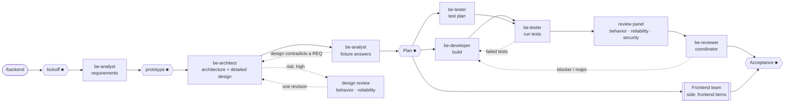

# Backend Agent Team

Builds the backend: requirements, architecture, code, tests and review. Interface work goes to the
[Frontend team](../frontend/README.md). Install and commands: the [root README](../README.md).

## How it works

**Your sign-offs (■):** the tier at kickoff; the prototype, running; **Plan**, one page of
requirements, decisions and fixture answers before any code; **Acceptance**.

- **Fixtures**: real inputs with expected outputs you approve at Plan; every later test must match
  them, and no agent may change them without you.
- **Review panel**: read-only reviewers, one lens each; a coordinator keeps only findings it cannot
  disprove. Only blockers and majors are fixed, and only the fixes are re-checked.
- **Risk**: a `high` round (money, personal data, auth, schema, public APIs …) adds a design review
  and the full panel.
- **Changes mid-run** join at the next sign-off as an increment; the run never restarts.
- Every round is a fresh agent; dotted arrows are fix loops through the orchestrator.

Rules in full: [`PLAYBOOK.md`](PLAYBOOK.md). Deliverables: `<project>/docs/backend/`.

## Team

| Agent | Role |
|---|---|
| `be-analyst` | Testable requirements and fixture answers (also the product role in frontend-only runs) |
| `be-architect` | Architecture and detailed design |
| `be-developer` | Builds the backend to the design |
| `be-tester` | Plans tests from the design, writes and runs them |
| `be-review-behavior` · `-reliability` · `-security` | Review panel, read-only |
| `be-reviewer` | Coordinates the panel; re-checks fixes |

## Customise

| Change | File |
|---|---|
| Models, panels, loop caps | `config.json`, or per project `<project>/.claude/backend.json` |
| Definition of done | `QUALITY-BARS.md` |
| Deliverable documents | `templates/` |
| Build and test commands for the gates | `<project>/.claude/gates.json` |
