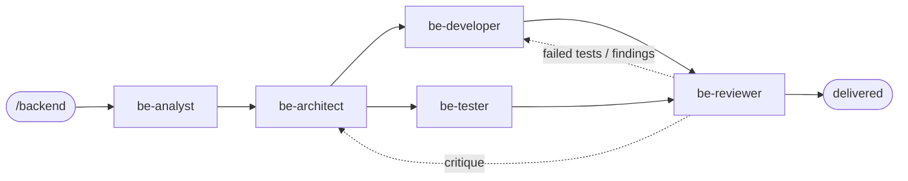

# Backend Agent Team

A phase-gated waterfall development team for Claude Code, installed globally. It builds the
backend; interface work goes to the Frontend team (PLAYBOOK §3C).

## Commands

| Command | Does |
|---|---|
| `/backend <what to build>` | Start a run (description or path to a brief) |
| `/backend-resume [phase]` | Continue an interrupted run |
| `/backend-status` | Read-only status, including gate results |
| `/backend-config [change]` | Show or change models, gates, lenses, caps |

## How it works

- **Solid arrows**: the order of work.
- **be-developer ∥ be-tester**: they work in parallel — code is built while the test plan is
  written from the design.
- **Dotted arrows**: fix loops back to the agent that owns the problem.
- **Orchestrator**: dispatches every step and runs automatic checks between steps (PLAYBOOK §3D).
- **Your sign-off**: twice. **Plan** (one page of requirements, decisions and test answers, before
  any code) and **Acceptance**. You are asked in between only when an answer would change what
  gets built.
- **Run log**: every dispatch, gate result, decision and your sign-offs go into a tamper-evident
  `run-log.jsonl`. `/backend-status` shows it as a timeline.
- **Deliverables**: `<project>/docs/backend/`.

## Team

| Agent | Role | Writes |
|---|---|---|
| Orchestrator | Plans, dispatches, runs gates, keeps state, reports | `state.json`, `07-acceptance.md` |
| `be-analyst` | Turns the request into testable requirements | `01-requirements.md` |
| `be-architect` | Designs the system, then every module | `02-architecture.md`, `03-detailed-design.md` |
| `be-developer` | Builds the backend exactly to the design | backend code, `08-implementation-log.md` |
| `be-tester` | Plans tests from the design, then writes and runs them | `04-test-plan.md`, tests, `05-test-report.md` |
| `be-reviewer` | Critiques the architecture, then reviews the code (read-only) | findings → `06-review-report.md` |

## Files

| Path | Change it to… |
|---|---|
| `~/.claude/CONSTITUTION.md` | change rules every agent must follow (yours alone to amend) |
| `backend/QUALITY-BARS.md` | raise the Definition of Done |
| `backend/PLAYBOOK.md` | change phase flow, gates, delegation |
| `backend/config.json` | change models, human gates, lenses, loop caps |
| `backend/templates/` | change the deliverable documents |
| `gates/` | change computational checks (keep `gates/tests` green) |
| `agents/be-*.md` | change one role (kept thin; they defer to the files above) |
| `backend/CHANGELOG.md` | record what changed and why |

Per-project overrides: `<project>/.claude/backend.json` and `<project>/.claude/gates.json`.
