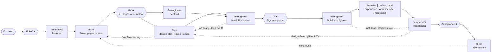

# Frontend Agent Team

A frontend team for Claude Code, installed globally, organised like real frontend work: product
decides what the product does, UX how the user gets through it, UI how it looks and feels, and the
frontend engineer makes it run on the real surface with real data. Backend work goes to the Backend
team. Usually entered through `/route`.

## Commands

| Command | Does |
|---|---|
| `/route <ask>` | Ask the tier, classify the work, start the right team |
| `/frontend <ask>` | Run the Frontend team directly |
| `/frontend-status` | Read-only status, gates, Figma budget and timeline |
| `/frontend-resume [phase]` | Continue an interrupted run |
| `/frontend-config [change]` | Show or change models, review panel, design stops, Figma budget |

An audit or review of an existing interface alone is not a run: name `fe-review-experience`,
`fe-review-accessibility` or `fe-review-integration` directly (and `fe-reviewer` to merge).

## How it works

- **■ Your sign-off**: the kickoff question (tier, models, risk, design stops, Figma budget),
  **UX** (flows, pages and state tables; only for 2+ pages or a new flow — otherwise UX is shown
  with the UI), **UI** (the frames in Figma and the queue of expected results; the frames are
  then exported and locked) and **Acceptance**. A Prototype-tier run ends at the UI stop.
- **Solid arrows**: the order of work — Phase 0 features (skipped in a cross-stack run, where the
  Backend team's requirements are the input), 1 UX, 2 UI ∥ scaffold then feasibility and queue,
  3 build, 4 verify ∥ review, acceptance, 5 after launch.
- **Scaffold**: while UI draws, the engineer builds what does not depend on visuals (data
  fetching, state handling, routing) — in two-stop runs, where the confirmed UX is the approved
  design. In one-stop runs it waits until after the UI stop.
- **Dotted arrows**: work flows back. Any role may raise a design-feedback item (DFB); its owner
  (UX for flows, pages and states, UI for looks) decides it; a change to something you confirmed
  comes back to you. Fix rounds take only blockers, majors and rows not done; a fresh tester and
  coordinator re-check only those.
- **Review panel**: experience always; accessibility when interactive components, forms or
  navigation changed; data & runtime when API calls, data loading or client state changed; all
  three at `risk: high`. The coordinator drops a candidate only with counter-evidence.
- **After launch**: your feedback and your users' feedback become insights (`INS-###`); the ones
  you pick start the next round as an increment.
- **Figma**: each run has a call budget proposed at kickoff (20 + 8 per page by default, under a
  300-a-month cap); you are told the calls used before each UI revision.
- **Cross-stack**: the Backend team's run drives; the UI stop is also its Prototype stop, and one
  Acceptance covers both (`route/FRONTEND_BACKEND_LINE.md` §4).
- **Checks**: automatic gates after every phase (shared with the Backend team); results you accept
  are registered and re-checked in every later round. A tamper-evident run log records every
  dispatch, sign-off and Figma call count.
- **Deliverables**: `<project>/docs/frontend/` (`00-requirements` … `06-feedback`, frame exports in
  `evidence/design/`) and the shared `contracts/FRONTEND_BACKEND_CONTRACT.md`.

## Team

| Agent | Role | Writes |
|---|---|---|
| `be-analyst` | Product features, in frontend-only runs | `00-requirements.md` |
| `fe-ux` | Flows, page structure, state tables, ASCII wireframes; post-launch insights | `01-ux.md`, `06-feedback.md` |
| `fe-ui` | Design plan and self-check, tokens, components, Figma frames | `02-ui.md`, Figma |
| `fe-engineer` | Scaffold, feasibility, the queue, then one row at a time; fixes | `03-queue.md`, frontend code, contract draft |
| `fe-tester` | One verdict per row against its frame and state rows | `04-verification.md`, tests |
| `fe-review-experience` · `-accessibility` · `-integration` | Review panel, read-only | returned candidates |
| `fe-reviewer` | Coordinator and re-checker | `05-review.md` |
| Orchestrator | Interviews, evidence capture, frame exports, gates, state | `state.json`, `evidence/` |

## Files

| Path | Change it to… |
|---|---|
| `~/.claude/CONSTITUTION.md` | change rules every agent follows (yours alone) |
| `frontend/QUALITY-BARS.md` | raise the Definition of Done |
| `frontend/PLAYBOOK.md` | change phases, stops, feedback routing |
| `frontend/config.json` | change models, review panel, design stops, Figma budget, viewports, caps |
| `frontend/templates/` | change the deliverables (examples in `templates/examples/`) |
| `route/FRONTEND_BACKEND_LINE.md` | change the line between the teams |
| `gates/` | change the automatic checks (keep `gates/tests` green) |
| `agents/fe-*.md` | change one role |
| `frontend/CHANGELOG.md` | record what changed and why |

Per-project: `<project>/.claude/project-context.md` (surface, named user, frontend/backend line,
taste choices) and `<project>/.claude/frontend.json`.

The agents that use Figma (`fe-ui`, `fe-engineer`) list the tools of the Figma plugin's MCP server
as `mcp__plugin_figma_figma__*`. If your Figma server is installed under another name, change that
entry in their frontmatter.
