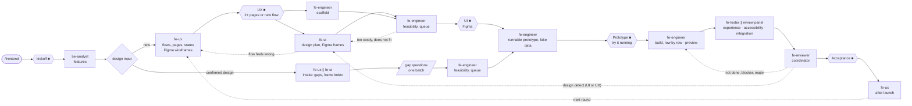

# Frontend Agent Team

Designs and builds interfaces people operate (web, native, desktop, game UI, terminal) the way a
real frontend team does: product decides what, UX how the user gets through it, UI how it looks,
engineering makes it run with real data. Install and commands: the [root README](../README.md).

## How it works

**Your sign-offs (■):** the tier at kickoff; **UX** (grey Figma wireframes) and **UI** (Figma
frames) for a new design (one combined stop for a single page); **Prototype**, the design running with fake data, plus the results you
expect from it; **Acceptance**.

- **Bring your own design**: a design you already confirmed is taken in, not redrawn; only its gaps
  are asked, once.
- **Running early**: the prototype is the start of the product, and from then on a preview address
  shows the build as it grows.
- **Work flows back**: UI can push back on UX and engineering on the design (a design-feedback
  item); a change to anything you confirmed comes back to you.
- **Review panel**: experience always; accessibility and data & runtime when the change calls for
  them; a coordinator keeps only findings it cannot disprove.
- **Figma budget**: each run has a call budget under your monthly cap; you see the count before
  each design revision.
- **After launch**: your and your users' feedback becomes insights that start the next round.

Rules in full: [`PLAYBOOK.md`](PLAYBOOK.md). Deliverables: `<project>/docs/frontend/`.

## Team

| Agent | Role |
|---|---|
| `be-analyst` | Product features in frontend-only runs |
| `fe-ux` | Flows, pages, state tables, wireframes (Figma when there is a UX stop); post-launch insights |
| `fe-ui` | Visual design, tokens, components, Figma frames |
| `fe-engineer` | Feasibility, build queue, prototype, then the build |
| `fe-tester` | Checks each built piece against its frame and states |
| `fe-review-experience` · `-accessibility` · `-integration` | Review panel, read-only |
| `fe-reviewer` | Coordinates the panel; re-checks fixes |

## Customise

| Change | File |
|---|---|
| Models, panel, design stops, Figma budget, screen sizes | `config.json`, or per project `<project>/.claude/frontend.json` |
| Definition of done | `QUALITY-BARS.md` |
| Deliverable documents | `templates/` |
| Surface, named user, taste, frontend/backend line | `<project>/.claude/project-context.md` |
