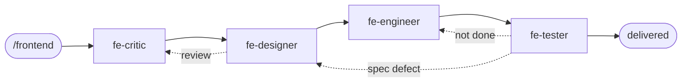

# Frontend Agent Team

A design-to-verified-interface team for Claude Code, installed globally. It designs the interface
and builds its frontend side; backend work goes to the Backend team. Usually entered through `/route`.

## Commands

| Command | Does |
|---|---|
| `/frontend new <ask>` | Design something new, ending in a design you approve |
| `/frontend redesign <ask>` | Audit what exists, then redesign it |
| `/frontend audit` · `review` | Findings only, on the product or on existing designs |
| `/frontend implement` | Build an approved design and verify it on the running interface |
| `/frontend status` | Read-only status, gates and timeline |
| `/frontend-resume [phase]` | Continue an interrupted run |
| `/frontend-config [change]` | Show or change models, lenses, caps |

## How it works

- **Solid arrows**: the order of work. fe-critic writes the brief, fe-designer the structure and
  spec, fe-engineer builds each queue row, fe-tester judges it on the running interface.
- **Dotted arrows**: loops. Specs go back to fe-critic for review; rows that did not take effect
  go back to fe-engineer; a spec the running interface contradicts goes back to fe-designer.
- **Orchestrator**: interviews you, writes the queue, and captures evidence from the running interface
  with a script (DOM, styles, accessibility tree, screenshots) at every committed screen size.
- **Your sign-off**: **Plan** (the design, or the queue of expected results before building) and
  **Acceptance** (after verification). You are asked in between only when an answer changes what
  gets built.
- **Priority**: every finding and row is P1–P3 against one named user; P1s first.
- **Checks**: automatic gates after every phase (shared with the Backend team); failures go back to
  their owner. Results you accept are registered and re-checked in every later round. A tamper-evident run log records every dispatch and sign-off.
- **Deliverables**: `<project>/docs/frontend/01-brief.md` … `06-verification.md`, plus the shared
  `contracts/FRONTEND_BACKEND_CONTRACT.md`.

## Team

| Agent | Role | Writes |
|---|---|---|
| Orchestrator | Interviews, captures evidence, writes the queue, keeps state | `state.json`, `05-queue.md`, `evidence/` |
| `fe-critic` | Brief, findings with side and priority, capability rulings (read-only) | text filed by the orchestrator |
| `fe-designer` | Structure, then specification and the contract draft | `02-structure.md`, `03-spec.md`, contract |
| `fe-engineer` | Builds one queue row at a time, frontend side only | frontend code |
| `fe-tester` | Verdict per row from captured evidence; assertions that can fail | tests, `06-verification.md` |

## Files

| Path | Change it to… |
|---|---|
| `~/.claude/CONSTITUTION.md` | change rules every agent follows (yours alone) |
| `frontend/QUALITY-BARS.md` | raise the Definition of Done |
| `frontend/PLAYBOOK.md` | change modes, phases, stops |
| `frontend/config.json` | change models, lenses, loop caps |
| `frontend/templates/` | change the deliverables (examples in `templates/examples/`) |
| `gates/` | change the automatic checks (keep `gates/tests` green) |
| `agents/fe-*.md` | change one role |
| `frontend/CHANGELOG.md` | record what changed and why |

Per-project: `<project>/.claude/project-context.md` (surface, named user, frontend/backend line)
and `<project>/.claude/frontend.json`.
